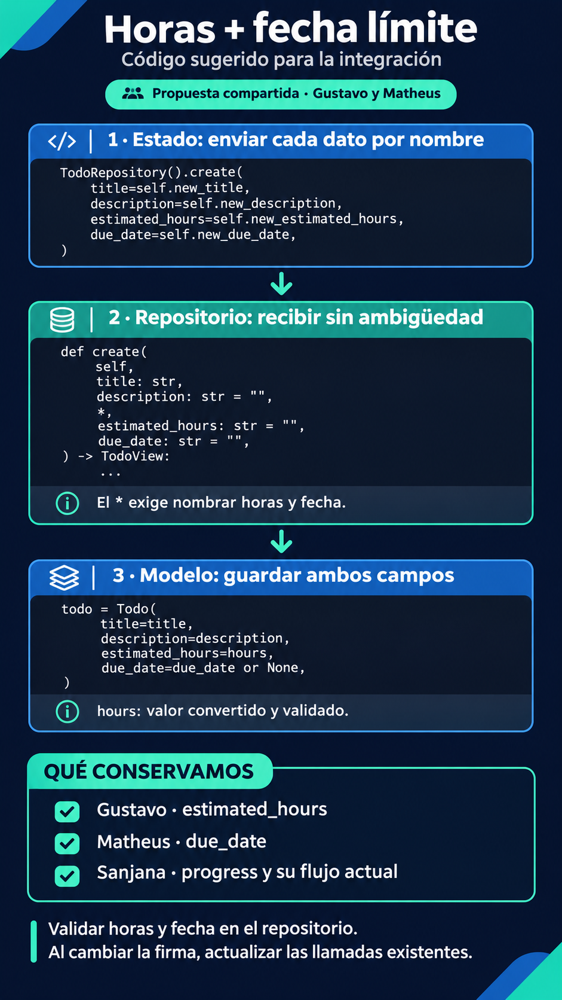
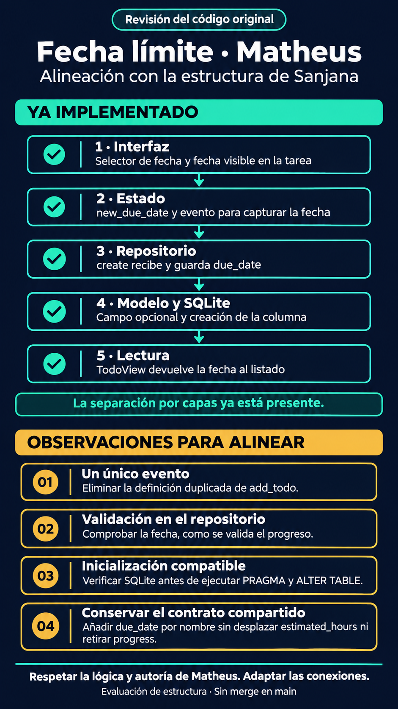

# Integración de horas, fecha límite y progreso

Trabajo en la rama `gustavo`, sin integrar en `main`.

## Procedencia y estructura

- Gustavo: `estimated_hours` y su validación.
- Matheus: fecha límite opcional `due_date`, captura en el formulario, persistencia y visualización en las tareas.
- Sanjana: `progress`, deslizador y flujo de actualización del progreso.

La adaptación conserva la separación interfaz → estado → repositorio → modelo/base de datos → vista/listado. La carpeta `todo_app_mateus/` es exclusivamente una base local de comparación y clasificación; se conserva sin modificaciones en el equipo y se excluye del seguimiento de Git. La aplicación activa es `todo_app`.

## Observaciones y resolución en esta rama

| Observación | Resolución |
| --- | --- |
| El original de Matheus declara dos veces `add_todo`. | La aplicación integrada conserva un único evento que envía título, descripción, horas y fecha. |
| Validar la fecha en el repositorio, como se valida el progreso. | Se admite fecha vacía o una fecha real con formato `AAAA-MM-DD`; los errores no borran los datos del formulario. |
| Ejecutar la migración únicamente para SQLite. | Se conserva la comprobación del motor y se añade la columna `due_date` si falta, junto a las migraciones de horas y progreso. |
| Pasar **horas y fecha por nombre**. | Ambos parámetros se sitúan después de `*` en `create`; la aplicación los envía explícitamente. Es un ajuste compartido de integración, no un fallo exclusivo de Matheus. |

## Código aplicado

Estado:

```python
TodoRepository().create(
    title=self.new_title,
    description=self.new_description,
    estimated_hours=self.new_estimated_hours,
    due_date=self.new_due_date,
)
```

Firma del repositorio:

```python
def create(
    self,
    title: str,
    description: str = '',
    *,
    estimated_hours: str = '',
    due_date: str = '',
) -> TodoView:
    ...
```

Tras validar y convertir las horas y validar la fecha:

```python
todo = Todo(
    title=title,
    description=description,
    estimated_hours=hours,
    due_date=due_date or None,
)
```

Las llamadas externas que pasaban horas como tercer argumento posicional deben usar `estimated_hours=...`. Las llamadas existentes del proyecto se han revisado.

## Gráficos





El segundo gráfico describe el original, no el estado de la adaptación. Su observación 04 debe leerse como un ajuste compartido de **horas y fecha**, tal como se precisa en la tabla anterior.

## Comprobación y alcance

Desde `intro/`:

```bash
uv run python -m unittest discover -s tests -v
```

Las pruebas cubren CRUD, persistencia conjunta de fecha/horas/progreso, validación de fecha y horas, migración repetible sin pérdida de datos y envío/limpieza del formulario. Usan bases temporales.

La fecha se asigna al crear la tarea; la edición existente sigue modificando título y descripción. Se conserva el comportamiento de Sanjana: la casilla ajusta el progreso a 100/0, pero mover el deslizador al 100 % no marca automáticamente la casilla. La revisión visual en navegador queda pendiente.
